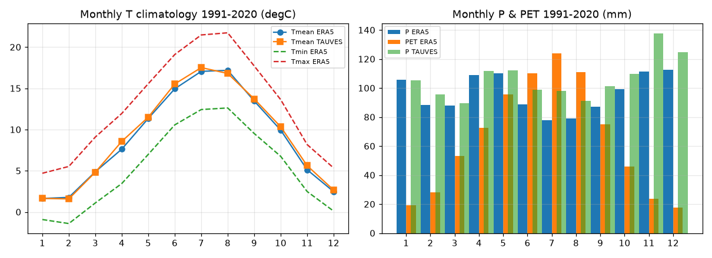
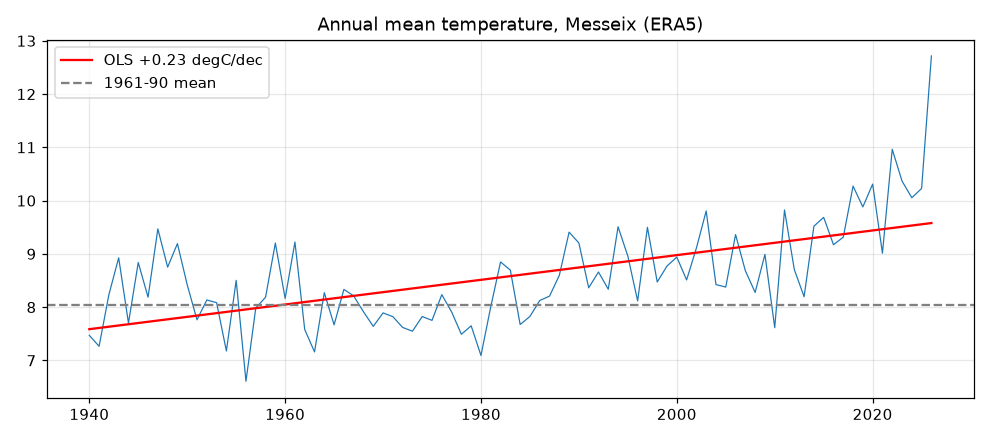
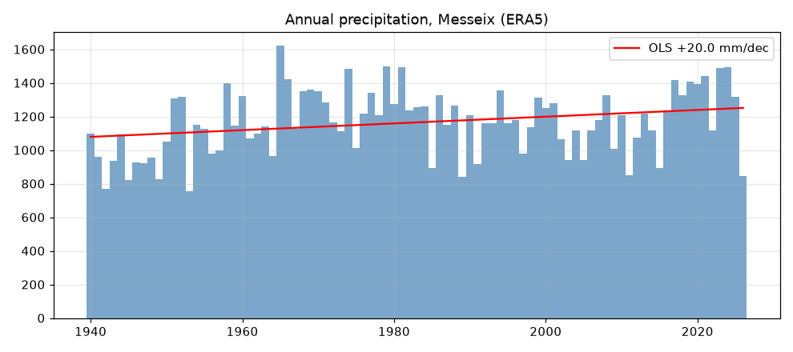
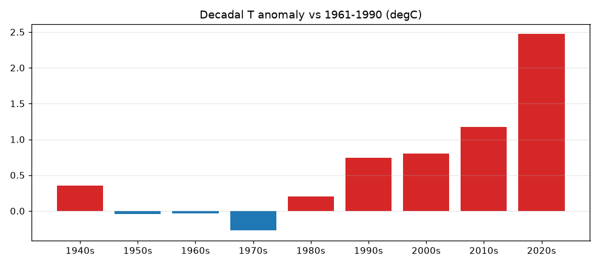
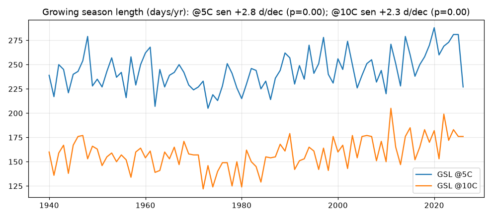
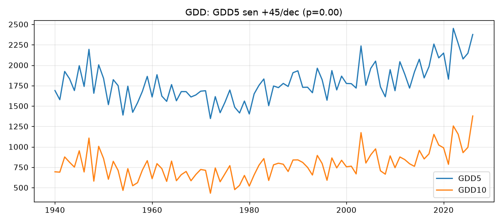
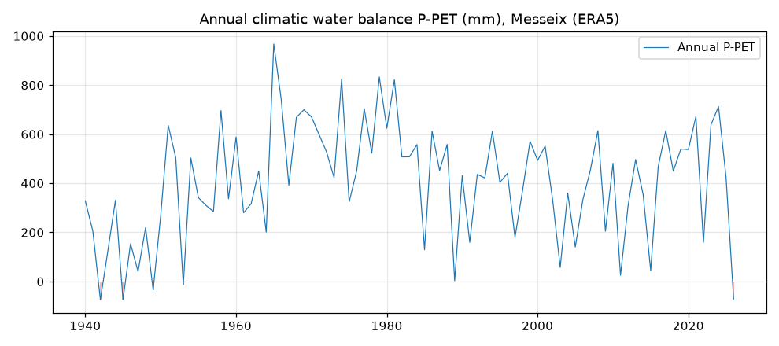
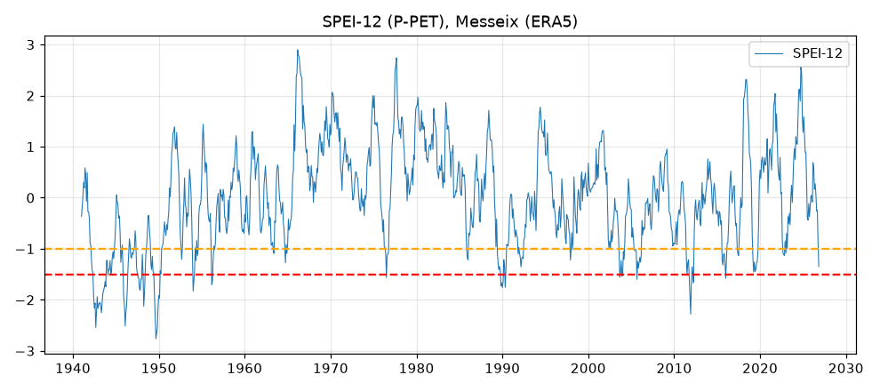
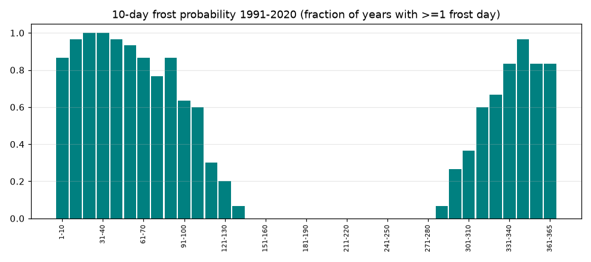

# Figures

Les figures du rapport sont générées par le notebook et enregistrées dans
`figures/`. Leur légende et interprétation figurent dans le
[Rapport climatique](CLIMATE_REPORT_Messeix.md).

## Climatologie et normales

## Tendances et évolution

## Indicateurs agroclimatiques

## Bilan hydrique et sécheresse

## Risque de gel

